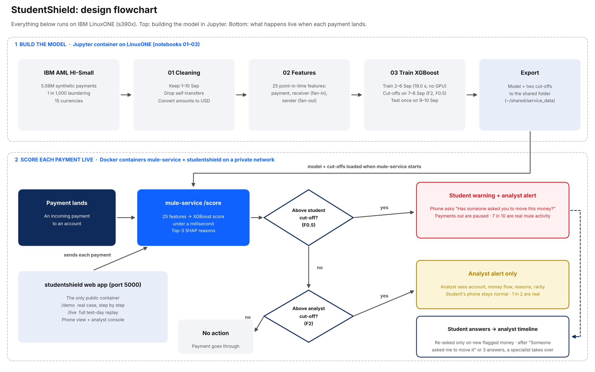

# Manchester.Ai_IBM Z Datathon 2026 Project

**StudentShield — real-time money-mule early warning on IBM LinuxONE**

**Team:** Manchester.Ai (University of Manchester hub)
**Event code:** SSF2026
**Theme:** 1 — Real-Time AI for Critical Decisions (fraud detection)
**Live prototype (LinuxONE):** http://148.100.108.113:5000
**Demo video:** _link_

---

## Problem

A money mule is the middle link in a laundering chain: dirty money lands in their account and they are told to forward it, usually within hours. Young people are recruited with "easy money" offers, often without realising it is a crime. Banks normally detect mules **after** the money has moved on, then freeze the account; the young person can lose their bank account and face a criminal record.

**The evidence:**
- **23%** of cases on the Cifas National Fraud Database showing money-mule behaviour involved young people aged 21 and under, and **64%** involved people aged up to 30 (Cifas & UK Finance, first half of 2023; 3,881 cases involving the youngest group).
- UK payment fraud losses reached **£1.28 billion** in 2025 (UK Finance, Annual Fraud Report 2026).

Students are the group being targeted, and the window between money arriving and being forwarded is where a warning can still help.

## Data

**IBM Transactions for Anti-Money Laundering (AML), HI-Small** — a synthetic dataset published by IBM (Altman et al., NeurIPS 2023 Datasets & Benchmarks).

| Fact | Value |
|---|---|
| Payments | 5,078,345 (4,486,418 after cleaning) |
| Accounts | 515,088 |
| Laundering payments | 5,177 (0.10%, about 1 in 1,000) |
| Currencies | 15, converted to US dollars with IBM's fixed rates |

Cleaning choices (full reasoning in [FINDINGS.md](FINDINGS.md)):
- Only 1–10 September used: from 11 Sep the generator stops producing normal payments, which would inflate any score.
- Self-transfers dropped (11.6% of rows, only 11 laundering).
- **Split by date, never randomly:** 1 Sep warm-up, 2–6 Sep train, 7–8 Sep validation, **9–10 Sep test** (~845k payments, 954 laundering, never seen in training or tuning).
- **Point-in-time features:** every feature uses only payments strictly before the one being scored, which is all a bank knows when the money lands.

## Solution

StudentShield scores each incoming payment **the moment it lands** and acts on two levels of the same score:

1. **Student warning** (strict cut-off): the account holder gets a plain-language, non-accusatory warning on their phone **before** they forward the money, outgoing payments are paused, and they are asked where the money came from.
2. **Analyst alert** (wider cut-off): the bank's analyst sees the flagged account, the money flow, the model's top reasons in plain English, and the student's answers.

**Model:** XGBoost on 25 point-in-time features in three groups — the payment (amount, format, first time these two accounts have transacted), the receiving account (age, new senders in 24 h, money passed through) and the sender (new receivers in 24 h, fan-out). Each alert's top 3 SHAP reasons become the explanation text (template text built from the model's reasons).

### Results (test days 9–10 Sep, real 0.1% laundering rate)

| Model | Recall @ 1% alerts | Precision @ 1% | PR-AUC |
|---|---|---|---|
| Rules baseline (bank-style rule) | 25.7% | 2.9% | 0.024 |
| **XGBoost (StudentShield)** | **69.5%** | **7.9%** | **0.430** |

Within ACH payments only (where "is it ACH?" tells you nothing): rules 2.0% recall vs model **53.6%** — the model learns mule behaviour, not just payment type.

Alert levels, each cut-off chosen with F-beta on validation and measured once on test:

| Level | Flagged | Laundering caught | Alerts that are real | False alarms / day |
|---|---|---|---|---|
| Analyst alert (F2) | 0.10% | 45.2% | 49.5% (1 in 2) | ~220 |
| Student warning (F0.5) | 0.06% | 37.8% | 69.7% (7 in 10) | ~78 |

Scoring takes **under a millisecond per payment** on LinuxONE.

## Architecture

```
IBM AML HI-Small (CSV)
      │
      ▼
Jupyter on LinuxONE (s390x)
  01_cleaning → 02_features (25 point-in-time features) → 03_models (XGBoost, SHAP reasons)
      │  model + cut-offs exported to ~/shared/service_data
      ▼
Docker network "mule-net" on the LinuxONE VM
  ┌───────────────────────────────┐        ┌──────────────────────────────────┐
  │ mule-service (Flask+XGBoost)  │◀──────▶│ studentshield (Flask front end)  │◀── browser :5000
  │ /score /alerts /explain       │        │ /  /demo  /live                  │
  │ /cases /health /demo/*        │        └──────────────────────────────────┘
  └───────────────────────────────┘
```



Full write-up: [docs/StudentShield_Project_Report.docx](docs/StudentShield_Project_Report.docx) ([PDF](docs/StudentShield_Project_Report.pdf)).

## Why IBM Z / LinuxONE

- **Everything runs on LinuxONE (s390x):** data loading, feature engineering, model training (XGBoost trained in 19.0 s on 2.09M payments, no GPU) and live scoring. `/health` reports `"machine": "s390x"`.
- **Containerised:** two Docker containers built on the LinuxONE Community Cloud base image (`registry.linuxone.cloud.marist.edu/l1cc/jupyterlab-image-s390x`), on a private Docker network, restarting automatically (`--restart unless-stopped`; they came back on their own after a VM restart).
- **Real-time:** under a millisecond to score a payment, so the warning can arrive before a mule forwards the money.
- **Security fit:** payment data and the model stay on the bank's own platform; only the scoring service talks to the front end.

## Running it on LinuxONE

1. Deploy an Ubuntu instance on LinuxONE Community Cloud (event code SSF2026) and open the Jupyter environment.
2. Download HI-Small from Kaggle into `~/shared`, then run `notebooks/01_cleaning`, `02_features`, `03_models` in order (Jupyter).
3. Export the model and cut-offs: `python service/export_for_service.py` (Jupyter terminal).
4. Build and run both containers (VM terminal):
   ```
   cd ~/shared/manchester-imbz-datathon-2026 && git pull
   docker network create mule-net 2>/dev/null || true
   docker build -t mule-service service/ && docker rm -f mule-service
   docker run -d --name mule-service --network mule-net --restart unless-stopped -v ~/shared/service_data:/data mule-service
   docker build -t studentshield frontend/ && docker rm -f studentshield
   docker run -d --name studentshield --network mule-net --restart unless-stopped -p 5000:5000 -e MODEL_URL=http://mule-service:5000 studentshield
   ```
5. Open `http://<vm-ip>:5000`.

Details: [service/README.md](service/README.md), [frontend/README.md](frontend/README.md).

## Screenshots

_In docs/screenshots/ (to add): LinuxONE dashboard, `uname -m` + `docker ps`, `/health`, notebook 03 training on s390x, /demo, /live._

## Ethics and limitations

- **Synthetic data:** results show the approach works; real-world accuracy needs real bank data.
- **Protect, don't accuse:** student wording is gentle; the student never sees the model's ground truth.
- **Strict cut-off for people:** the student level is precision-weighted (F0.5) so innocent students are rarely interrupted; holds only happen at that level.
- **Human in the loop:** an analyst reviews every alert; the model never freezes an account on its own.
- The "Student (persona)" in the demo is illustrative; the payments are real rows of the synthetic dataset.

## Open-source libraries used

- [XGBoost](https://github.com/dmlc/xgboost) — model, and per-alert SHAP reasons (`pred_contribs`)
- [pandas](https://pandas.pydata.org/) — data processing
- [NumPy](https://numpy.org/) — numerics
- [scikit-learn](https://scikit-learn.org/) — evaluation metrics
- [Flask](https://flask.palletsprojects.com/) — scoring service and front end
- [Jupyter / JupyterLab](https://jupyter.org/) — notebooks on LinuxONE
- [Docker](https://www.docker.com/) — containers

## Sources

- IBM, *Transactions for Anti Money Laundering (AML)*, Kaggle: https://www.kaggle.com/datasets/ealtman2019/ibm-transactions-for-anti-money-laundering-aml
- Altman et al., *Realistic Synthetic Financial Transactions for Anti-Money Laundering Models*, NeurIPS 2023: https://arxiv.org/abs/2306.16424
- UK Finance & Cifas, money-mule figures for H1 2023: https://www.ukfinance.org.uk/news-and-insight/press-release/uk-finance-and-cifas-launch-lessons
- UK Finance, *Annual Fraud Report 2026*: https://www.ukfinance.org.uk/policy-and-guidance/reports/annual-fraud-report-2026

## Team

- Thinojen Balakumaresan (lead) — platform / LinuxONE
- Sshubhan Kammari — data & model
- Julian Newson
- Arda Yencer
